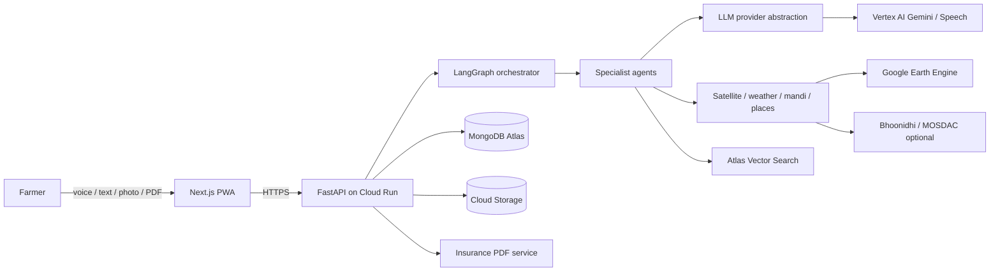
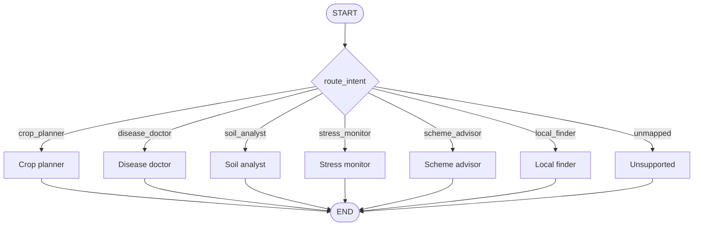

# Architecture

## System context

## Request flow

1. The PWA sends text, a voice transcript, an image, or a PDF to FastAPI.
2. FastAPI validates the request with Pydantic v2 and builds an `AgentState`.
3. The orchestrator classifies intent and dispatches to one specialist node.
4. The specialist retrieves evidence and calls the provider-agnostic LLM layer.
5. Structured output is validated against a Pydantic schema before persistence.
6. The API stores artifacts in GCS and metadata in MongoDB, then replies.
7. For voice sessions, the reply is synthesized with Google TTS (`hi-IN`).

## Agent graph

The current router trusts an already-classified `AgentState.intent`. It is a
placeholder; production intent classification will use Gemini structured output.
Every specialist agent currently raises `NotImplementedError`.

## Specialist responsibilities

| Agent | Inputs | Outputs | External evidence |
| --- | --- | --- | --- |
| Crop planner | Season, location, soil, climate history, mandi data | Ranked crop plan | Weather, mandi prices |
| Disease doctor | Crop photo, crop, farm context | `DiagnosisResult` with two grounded remedies | RAG corpus, Gemini vision |
| Soil analyst | Soil-test PDF/image | Mineral recommendations | OCR, RAG corpus |
| Stress monitor | Farm polygon, date window | NDVI anomaly, NDMI, LST, soil moisture, score | Earth Engine; optional ISRO |
| Scheme advisor | Question, state, crop | Eligibility hints and cited passages | Atlas Vector Search |
| Local finder | Location, radius, place type | Nearby shops and mandis | Places API, MongoDB GeoJSON |
| Report service | Farm, claim window, photos | Insurance evidence PDF | Stress monitor, weather, GCS |

## Diagnosis safety contract

`DiagnosisResult` requires:

- `confidence`: float between 0 and 1.
- `disclaimer`: non-empty string directing the farmer to a local KVK.
- `sources`: at least one retrieved source.
- `remedies`: exactly two entries, one chemical-fertilizer and one organic/cow-dung
  option, each citing retrieved document IDs.

Remedies must never be generated free-form. If retrieval is insufficient, the
agent should return an abstention or ask for more evidence instead of guessing.

## Data model

MongoDB Atlas collections:

- `farmers` — profile, language, experience mode.
- `farms` — GeoJSON boundary with a `2dsphere` index.
- `diagnoses` — validated diagnosis results and source references.
- `soil_reports` — extracted lab values and recommendations.
- `scheme_chunks` — chunk text, source metadata, embeddings (Atlas Vector Search).
- `places` — cached shops and mandis with GeoJSON points.
- `insurance_reports` — report metadata and GCS PDF URI.

Cloud Storage holds source images, soil reports, generated PDFs, and optional
synthesized audio. Databases store URIs, not binary blobs.

## Provider abstraction

`app/llm/provider.py` defines `LLMProvider` and `SpeechProvider` abstract base
classes. `GeminiProvider` and `GoogleSpeechProvider` are the initial adapters.
Agents and routes must not import vendor SDKs directly, so models can be swapped.

## Failure and safety behavior

- Missing cloud credentials must not prevent `/health` from returning 200.
- External calls need timeouts, bounded retries, and circuit breakers.
- Advice must distinguish observations, estimates, and confirmed facts.
- Insurance reports are advisory evidence, not proof of loss or approval.
- Do not log farmer PII, precise coordinates, uploaded media, or secrets.
- Hindi (`hi-IN`) is the default language; English is available as a fallback.

## Current scaffold status

Working: app startup, health check, route contracts, Pydantic schemas, Next.js
shell, test harness, CI/deploy definitions.

Stubbed: every agent, all external data tools, RAG ingestion/retrieval, database
repositories, PDF generation, speech, and all product endpoints.
